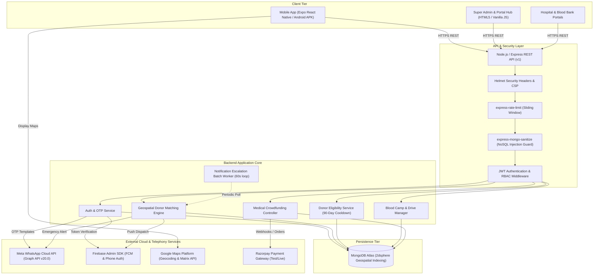
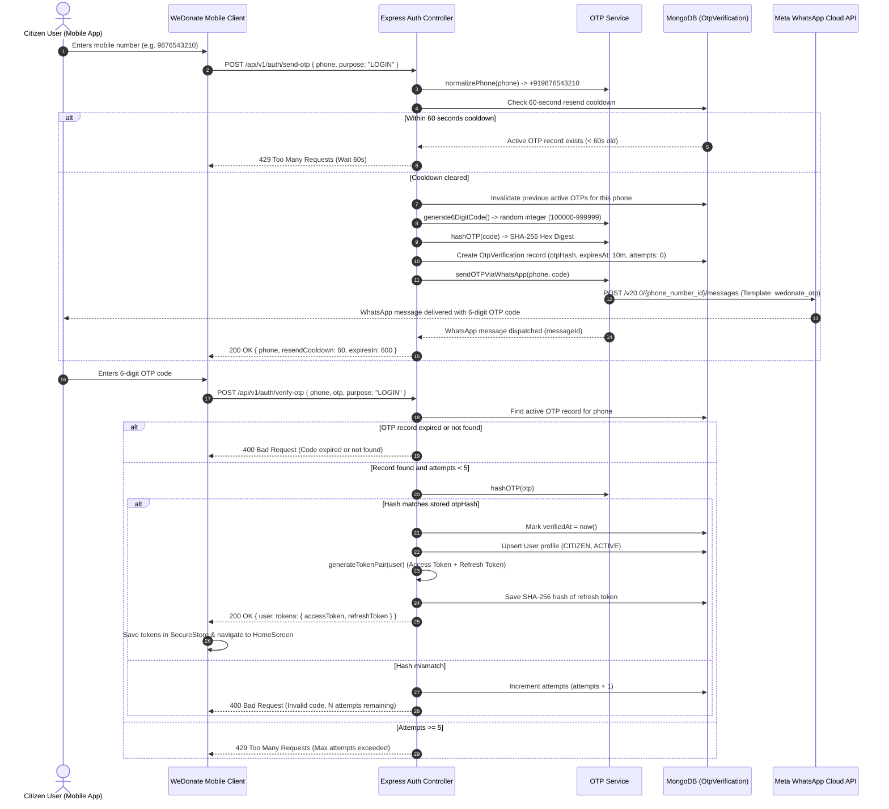
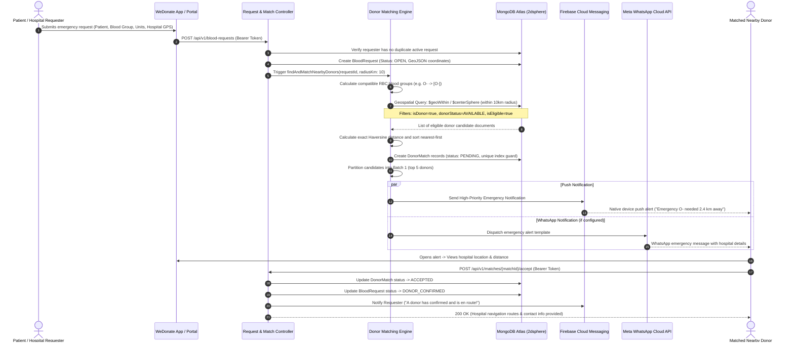
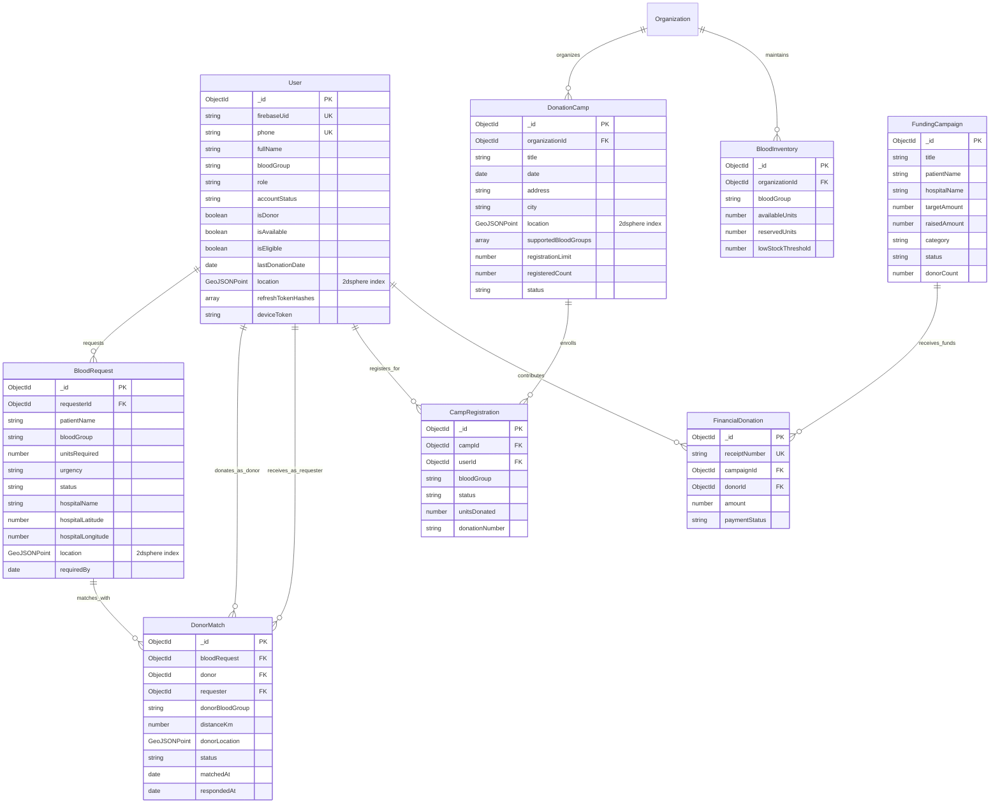

# WE DONATE — Technical Architecture & System Design Document

This document provides a comprehensive technical architectural specification of the **WE DONATE** emergency blood donor matching, blood camp drive, and medical crowdfunding platform.

---

## 1. System Architecture Overview

WE DONATE is an open-source, social-impact healthcare technology platform designed to bridge the life-critical gap between emergency patients requiring blood and nearby compatible, voluntary donors. The system coordinates citizens, hospital administrators, blood bank officers, and camp organizers in real time.

---

## 2. Component Responsibilities

### 2.1 Mobile Application (`src/`)
* **Technology:** React Native (0.76.7) with Expo SDK 52, TypeScript, Zustand state management.
* **Responsibilities:**
  - Citizen onboarding via phone number input and WhatsApp OTP verification.
  - Emergency blood request initiation with real-time GPS coordinate capture (`expo-location`).
  - Incoming request alerts with donor accept/reject controls (`IncomingBloodRequestScreen`).
  - Interactive map view of nearby compatible donors using `react-native-maps`.
  - Blood donation camp discovery and instant registration (`DonationCampsScreen`).
  - Medical crowdfunding exploration and contribution feed (`FundingScreen`).
  - Automatic in-app update notifications with version resolution and direct APK download (`AppUpdateModal`).
  - Offline-safe JWT token storage using `expo-secure-store`.

### 2.2 Backend API (`backend/`)
* **Technology:** Node.js (>=20.0), Express 4.21, Mongoose 8.7, Winston logging.
* **Responsibilities:**
  - RESTful API routing under `/api/v1/*` with strict input sanitization.
  - WhatsApp OTP dispatch and cryptographically secure hash validation (`otpService.js`).
  - Double-token authentication: short-lived access tokens (30 min) and rotating hashed refresh tokens (30 days).
  - Multi-portal static asset serving with cache control headers (`/portal/admin`, `/portal/hospital`, `/portal/blood-bank`).
  - Role-Based Access Control (`CITIZEN`, `HOSPITAL_STAFF`, `HOSPITAL_MANAGER`, `BLOOD_BANK_MANAGER`, `CAMP_ORGANIZER`, `ADMIN`, `SUPER_ADMIN`).
  - Asynchronous background worker (`notificationCampaignService.js`) running every 60 seconds to escalate unfilled emergency requests to secondary donor tiers.

### 2.3 Database Tier (MongoDB Atlas)
* **Storage Model:** MongoDB with Mongoose ODM schemas.
* **Key Capabilities:**
  - Geospatial discovery utilizing `2dsphere` indexes on user and hospital coordinates.
  - TTL (Time-To-Live) automatic index expiration for OTP verification tokens (`expires: 0`).
  - Unique compound constraints preventing duplicate donor match assignments and duplicate camp registrations.

---

## 3. Core Interaction & Sequence Flows

### 3.1 WhatsApp OTP Authentication Sequence

---

### 3.2 Emergency Blood Request & Geospatial Donor Matching Flow

---

## 4. Database Models & Schema Relationships

---

## 5. Security, Privacy & Failure Handling

### 5.1 Privacy & Data Protection
* **Phone Number Masking:** Mobile phone numbers are masked in logs, diagnostics, and notifications (`+91 98XXX XX210`).
* **Cryptographic OTP Hashes:** Plaintext OTP codes are never written to database collections, stored in log streams, or exposed in API payloads. Only one-way SHA-256 hashes are persisted with short 10-minute TTL expiration.
* **Token Security:** Raw refresh tokens are never persisted in the database; only SHA-256 digests are stored, enabling secure rotation and immediate revocation upon compromised reuse detection.

### 5.2 Fault Tolerance & Failure Handling
* **Meta WhatsApp Fallback:** If Meta WhatsApp Cloud API credentials are unset, disabled, or encounter rate limits, the system records errors without crashing and gracefully falls back to FCM push notification dispatch.
* **Geospatial Resiliency:** In the absence of live donor coordinates or GPS permission denial on client devices, users are guided through explicit location settings without crashing background processes.
* **Database Connection Auto-Healing:** MongoDB connections utilize reconnect retry logic with server selection timeouts, and health endpoints report degraded states (`503 Service Unavailable`) rather than terminating the Express process.
